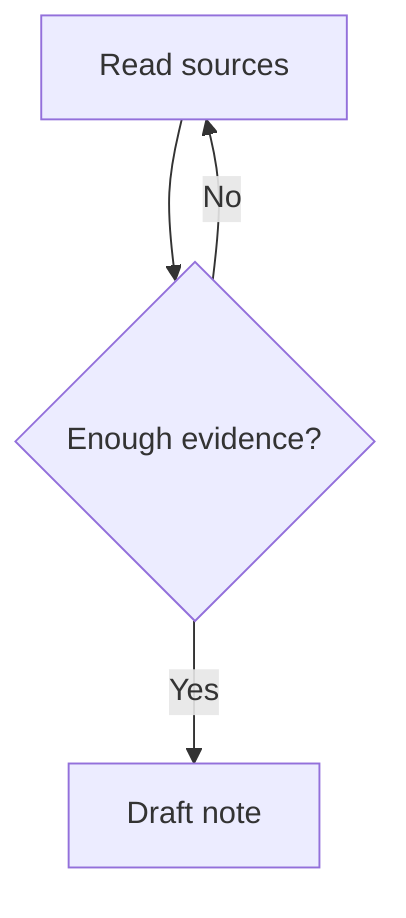

# Mermaid in Obsidian

Put each diagram inside a Markdown fence labelled `mermaid`. Write the diagram source inside the fence so Obsidian renders it in Reading view and Live Preview. Use a flowchart for relationships and decisions, a sequence diagram for interactions, or a timeline for ordered events. Use short, unique IDs and quote labels that contain punctuation. Keep diagrams small enough to read in a note.

To link a flowchart node to a vault note, use the note name as its visible label and assign the node the `internal-link` class. For example, `N["Study plan"]` with `class N internal-link;` links to Study plan. Use links only when the target is known. Preserve existing node IDs, directions, edges and links when editing, except where the requested change requires updating them.

Reference: https://obsidian.md/help/advanced-syntax#Diagram
